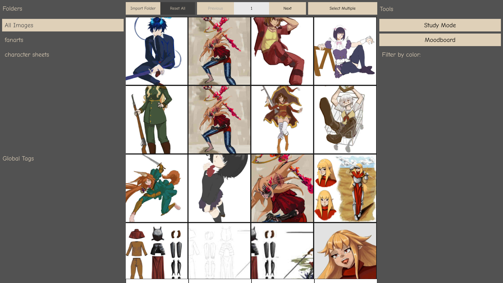
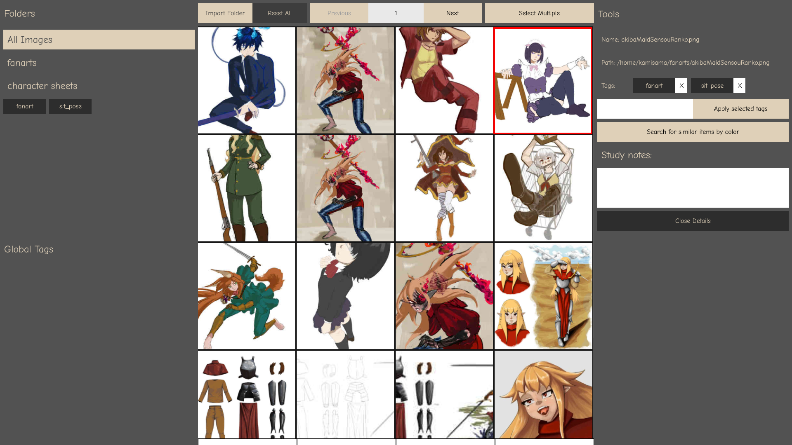
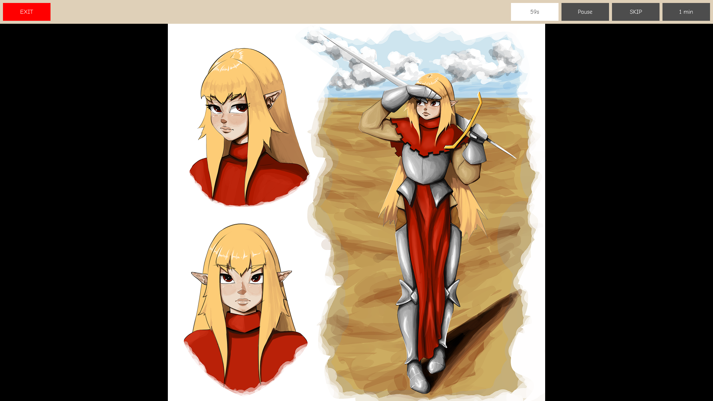
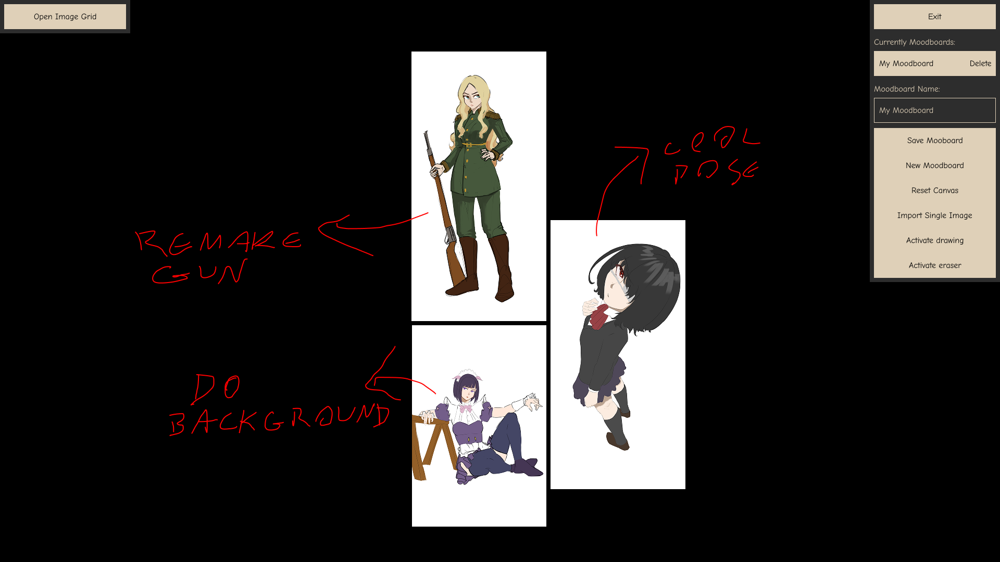

# Tech stack and technical decisions:
- Frontend: React, TypeScript
- Backend & Runtime: Tauri v2 (Rust)
- Database: SQLite
- Key Rust Crate Ecosystem: sqlx, tokio, walkdir, image, kmeans, palette
- AI Assistance: Used for building color search algorithms and troubleshooting Rust/SQL during development
- Why Rust + Tauri instead of Electron?
- Building a high-performance Digital Asset Manager requires fast file indexing, background thumbnail generation, and a responsive UI all running simultaneously. Electron’s higher RAM footprint and single-threaded nature wouldn't provide the level of performance this tool demands, so I chose Rust despite being on my learning journey with it!

# Figma design project
(https://www.figma.com/design/IRei9WFXCm5gTvm3PWZ9kJ/Propositum-Formarum?node-id=0-1&t=eFbOmrgtHtUYvdmE-1)

# Screenshots
- Main page:

- Selected Image:

- Study Mode:

- Moodboard:

